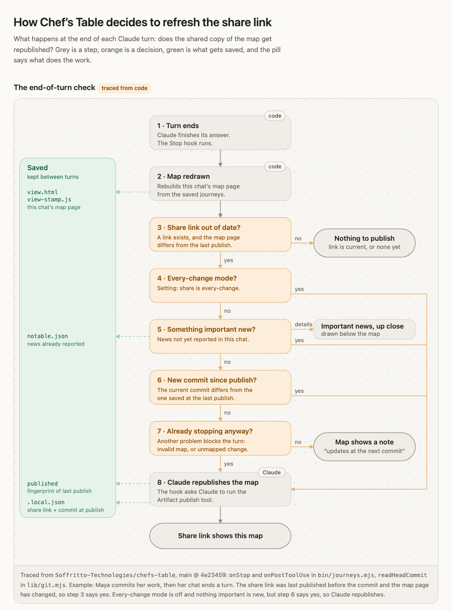

# Recipe

*A [Soffritto Technologies](https://github.com/Soffritto-Technologies) project.*

**See how your code works, drawn as a flow you can read.**

Recipe is a Claude skill. Ask it to draw how a piece of code works and it builds a whiteboard-style board: grey steps, orange decisions, a green "Saved" lane for what gets stored, red dashes where something is missing, and a small pill on every step saying whether plain code or an AI does the work. It is published as a page you can share, and it is written for someone who does not read code.

Chef's Table shows the menu (what people can do in your app). Recipe shows how each dish is made. Chef's Table is here: [Soffritto-Technologies/chefs-table](https://github.com/Soffritto-Technologies/chefs-table).



The full board, with its step-by-step close-up and findings, is [docs/sample.html](docs/sample.html). It was traced from Chef's Table's own open-source code.

## What people use it for

**Review what your AI built.**
Read the board instead of the diff. Every step is traced from the real code, so you see what actually happens, not what someone says happens.

**Plan the logic before building.**
Draw the flow first, spot the missing branch, then let the agent build it.

**Keep a paper trail.**
A board per feature records what a build does, in the order it does it, with the commit it was traced from.

**Debug.**
Gaps and "check this" marks are drawn right on the flow, so you can see where a path leaks, loops or goes nowhere.

## Install

### Claude Code

Run these two commands yourself, in a terminal:

```bash
claude plugin marketplace add Soffritto-Technologies/recipe
claude plugin install recipe@recipe
```

Or type them into the Claude Code prompt:

```
/plugin marketplace add Soffritto-Technologies/recipe
/plugin install recipe@recipe
```

> **Install it yourself, not by asking Claude.** If you ask Claude to install it while auto mode is on, auto mode stops the install with "Untrusted Code Integration". That is auto mode working as intended: a person should be the one who chooses to install a plugin. When you run the commands yourself, that check never comes up.

### Claude chat (web or desktop)

1. Build the zip: `sh scripts/build-zip.sh` (it writes `dist/recipe.zip`).
2. In Claude, open Settings, then Capabilities, then Skills, and upload `dist/recipe.zip`.

## How to ask

- "Draw a Recipe of how checkout works."
- "Make a board of this PR."
- "Diagram the flow of the signup code so I can review it."

Claude reads the code, draws the board, and publishes it as an artifact. Ask for changes and it updates the same artifact. In chat, with no code to read, it draws from what you describe and says so in the caption.

## What it runs

Nothing. Recipe is a skill only: a text file of instructions and one HTML template. It has no hooks, no scripts that run on your machine and no dependencies. It makes no network calls beyond publishing the artifact you ask for. The `scripts/build-zip.sh` helper is only for building the upload zip yourself.

## Works well with

- [Chef's Table](https://github.com/Soffritto-Technologies/chefs-table): the sister project, a map of what people can do in your app.
- [graphify](https://github.com/safishamsi/graphify), by Safi Shamsi, MIT: it indexes a codebase so Claude can find the right files cheaply before tracing a board.

## Contributing

Small, focused pull requests are welcome. Run `node --test` before you send one.

MIT licensed.
